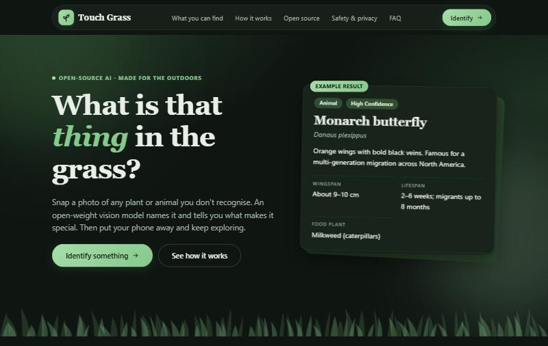

# Touch Grass

## Description

**Touch Grass** is an open-source web application designed to encourage people to explore the outdoors. Spot a plant, animal, or fungus you don't recognise? Snap a photo, and an open-weight vision model identifies it and returns a rich field-guide card with its common and scientific names, key identification features, lifespan, range, fun facts, and safety notes. Once you learn what you're looking at, put your phone away and get back to the trail!

Photos are downscaled and stripped of GPS/EXIF metadata directly in your browser before transmission, and are never saved to a database or disk.



---

## Features

- **Instant Wildlife & Plant Identification:** Identifies plants, animals, insects, birds, and fungi using open-weight multimodal vision models.
- **Client-Side Privacy & Compression:** Downscales images to $\le 1024\text{ px}$ on-device via HTML5 Canvas, stripping GPS coordinates and EXIF metadata while reducing upload payload size.
- **Detailed Field-Guide Cards:** Displays category, confidence level, key features, lifespan, habitat, range, fun facts, safety alerts, and alternative possibilities for lower-confidence scans.
- **Responsive & Accessible UI:** Fast, mobile-first design featuring smooth scrolling, a mobile drawer menu, scroll-spy section highlighting, and native light/dark theme adaptation.
- **Built-in Security & Resilience:**
  - Strict Content Security Policy (`CSP`) and restricted permissions.
  - LLM outputs are rendered exclusively with `textContent` DOM nodes to prevent XSS and prompt injection.
  - In-memory per-IP sliding window rate limiting.
  - Graceful handling for non-nature photos, model timeouts, and offline states.

---

## Tech Stack

- **Frontend:** HTML5 (Semantic), CSS3 (Custom Properties, Flexbox, Grid), Vanilla JavaScript (ES6+, DOM APIs, Canvas API)
- **Backend:** Node.js ($\ge 20$), Express (Single runtime dependency)
- **AI Engine:** Any OpenAI-compatible multimodal endpoint:
  - **Local:** [Ollama](https://ollama.com) (`qwen2.5vl:7b`)
  - **Cloud / Hosted:** [OpenRouter](https://openrouter.ai), [Google Gemini](https://ai.google.dev), or [Together AI](https://together.xyz)
- **Deployment:** Render (via `render.yaml` Blueprint or Web Service)

---

## Folder Structure

```
Touch Grass-1/
├── server.js              # Express backend, security headers, rate limiter, API proxy
├── package.json           # Dependencies and npm scripts
├── render.yaml            # Render Blueprint deployment configuration
├── .env.example           # Template for environment variables
├── .gitignore             # Git ignore configuration
├── public/                # Static client-side assets
│   ├── index.html         # Single-page layout (7 sections)
│   ├── style.css          # Responsive design, color tokens, dark mode
│   ├── app.js             # Image resizing, network calls, DOM rendering
│   ├── boot.js            # Progressive enhancement pre-paint script
│   └── favicon.svg        # Vector favicon
└── static/
    └── images/
        └── Home.png       # Application screenshot
```

---

## Installation Guide

### Prerequisites
- [Node.js](https://nodejs.org) ($\ge 20.0.0$)
- Either [Ollama](https://ollama.com) installed locally **OR** an API key from an OpenAI-compatible hosted provider (e.g. OpenRouter, Gemini).

### Step 1: Clone the Repository
```bash
git clone https://github.com/your-username/touch-grass.git
cd touch-grass
```

### Step 2: Install Dependencies
```bash
npm install
```

### Step 3: Configure Environment Variables
Copy the example environment file:
```bash
cp .env.example .env
```

Choose your AI backend in `.env`:

- **Option A: Local Ollama (Default)**
  ```bash
  ollama pull qwen2.5vl:7b
  ```
  In `.env`:
  ```ini
  AI_BASE_URL=http://localhost:11434/v1
  AI_MODEL=qwen2.5vl:7b
  AI_API_KEY=ollama
  ```

- **Option B: Cloud Provider (e.g. OpenRouter for Render)**
  In `.env`:
  ```ini
  AI_BASE_URL=https://openrouter.ai/api/v1
  AI_MODEL=qwen/qwen-2.5-vl-7b-instruct
  AI_API_KEY=your_openrouter_api_key
  ```

### Step 4: Start the Server
- **Development mode (with watch and auto-reload):**
  ```bash
  npm run dev
  ```
- **Production mode:**
  ```bash
  npm start
  ```

### Step 5: Open in Browser
Visit [http://localhost:3000](http://localhost:3000) (or `http://localhost:3001` if configured via `PORT`). To test from your phone on the same Wi-Fi network, navigate to `http://<your-laptop-ip>:3000`.

---

## Future Improvements

- **Local Observation Logbook:** Allow users to save their identifications locally using `IndexedDB` or `localStorage` to maintain a personal species diary without compromising privacy.
- **Multi-Photo Angles:** Support uploading multiple photos of a single specimen (e.g., flower petal, leaf shape, and tree bark) for greater identification precision.
- **Audio Recognition:** Add bird song and insect call identification using multimodal audio-capable models.
- **Geographic Biome Filtering:** Provide optional broad regional selection (e.g. Pacific Northwest, Mediterranean) to assist the vision model with local subspecies and seasonal variations.
- **Progressive Web App (PWA):** Add a web manifest and service worker for offline shell caching and home screen installation on mobile devices.
